<div align="center">


# Indie Copilot

**Planeje seu produto e converse com uma IA que conhece o seu projeto, tudo no seu computador.**

[Baixar](https://github.com/marcuth/indie-copilot/releases) · [Primeiros passos](#-primeiros-passos) · [Funcionalidades](#-o-que-você-pode-fazer) · [Perguntas frequentes](#-perguntas-frequentes)

</div>

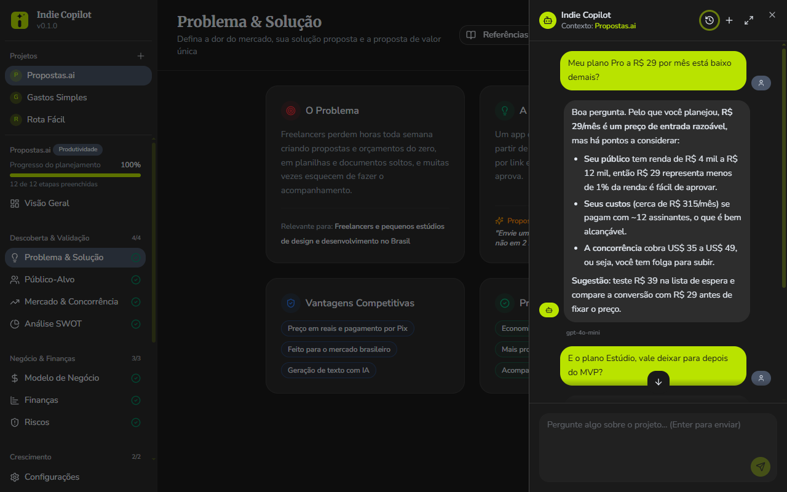

---

## 💡 O que é

O **Indie Copilot** é um aplicativo de desktop para quem está criando um produto sozinho (ou com uma equipe pequena). Ele junta duas coisas:

1. **Um caderno de planejamento estruturado**, que guia você do problema que quer resolver até o roadmap e a infraestrutura.
2. **Um chat com IA** que lê tudo o que você escreveu e responde com base no _seu_ projeto, sem você precisar explicar o contexto toda vez.

Você escolhe qual IA usar, e seus dados nunca saem do seu computador (exceto as mensagens que você mesmo envia ao provedor de IA escolhido).

## ✨ O que você pode fazer

### 🗂 Organizar vários projetos

Crie um projeto para cada ideia, com nome, descrição e logo. Acompanhe quanto do planejamento de cada um já está preenchido.

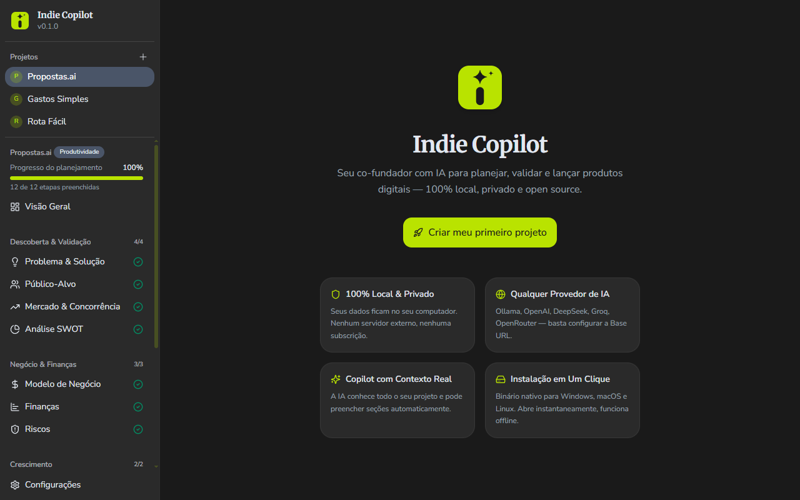

### 📝 Planejar em seções guiadas

Em vez de uma página em branco, você preenche seções pensadas para indie hackers, agrupadas por etapa:

| Etapa                      | Seções                                           |
| -------------------------- | ------------------------------------------------ |
| **Descoberta & Validação** | Problema & Solução, Público-Alvo, Mercado & Concorrência, Análise SWOT |
| **Negócio & Finanças**     | Modelo de Negócio, Finanças, Riscos              |
| **Crescimento**            | Aquisição de Usuários, Marketing                 |
| **Execução**               | Roadmap, Equipe, Infraestrutura                  |

Além delas, há a **Visão geral** do projeto e as **Notas**, para ideias soltas e anotações.

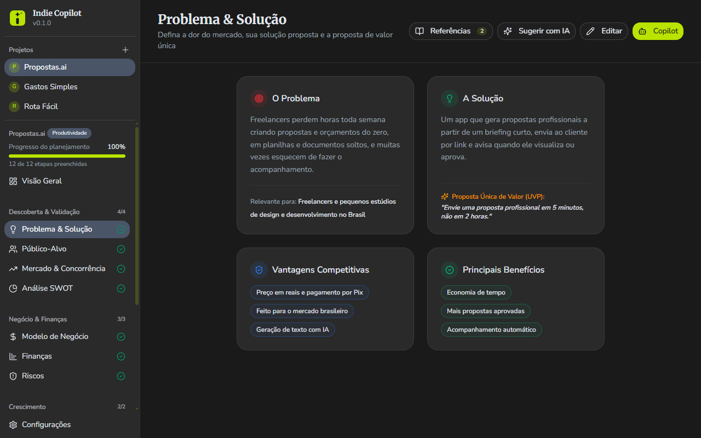

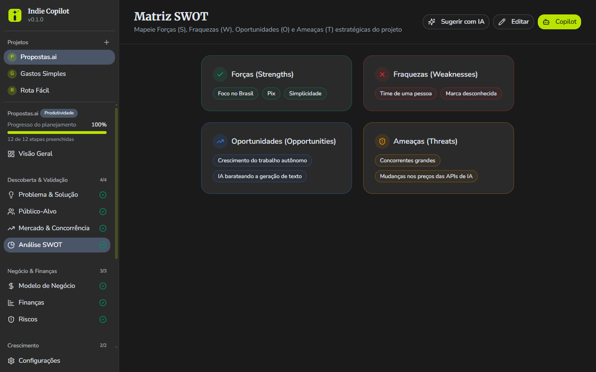

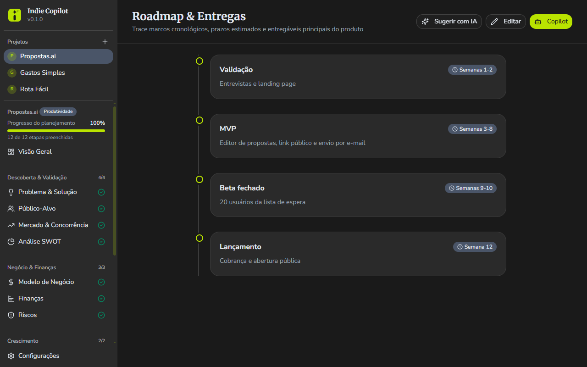

### 📊 Ver seu progresso

A visão geral mostra quantas seções você já preencheu, no total e por etapa, para você saber o que ainda falta pensar antes de lançar.

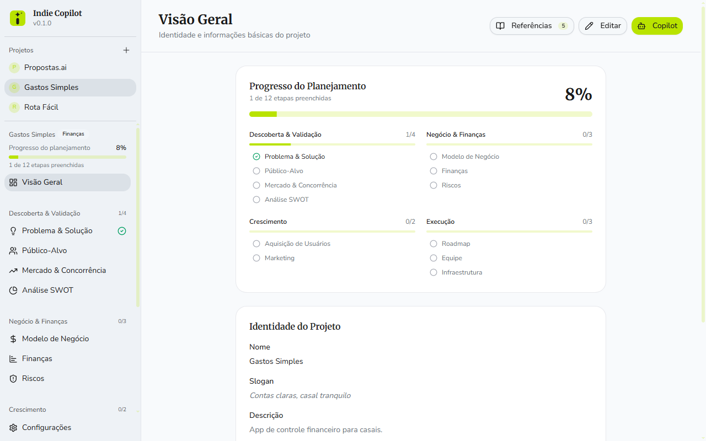

### 🤖 Conversar com o Copilot

Abra o chat em qualquer página do projeto e pergunte o que quiser: "Quais são os pontos fracos do meu modelo de negócio?", "Sugira 3 canais de aquisição para o meu público", "Revise meu roadmap". O Copilot enxerga todo o seu planejamento, então as respostas são específicas para o seu produto.

- Respostas em tempo real, com formatação (listas, tabelas, código, links).
- Painel lateral que pode ser **expandido para tela cheia** sem perder a conversa.

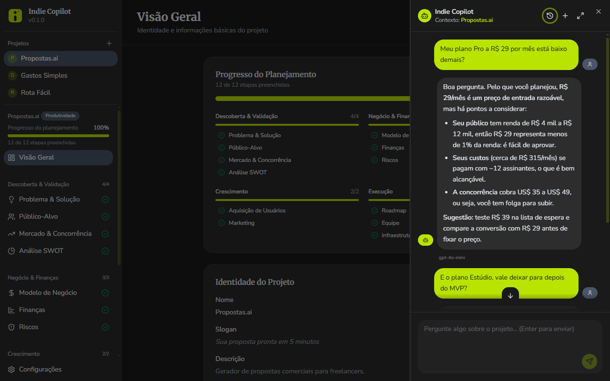

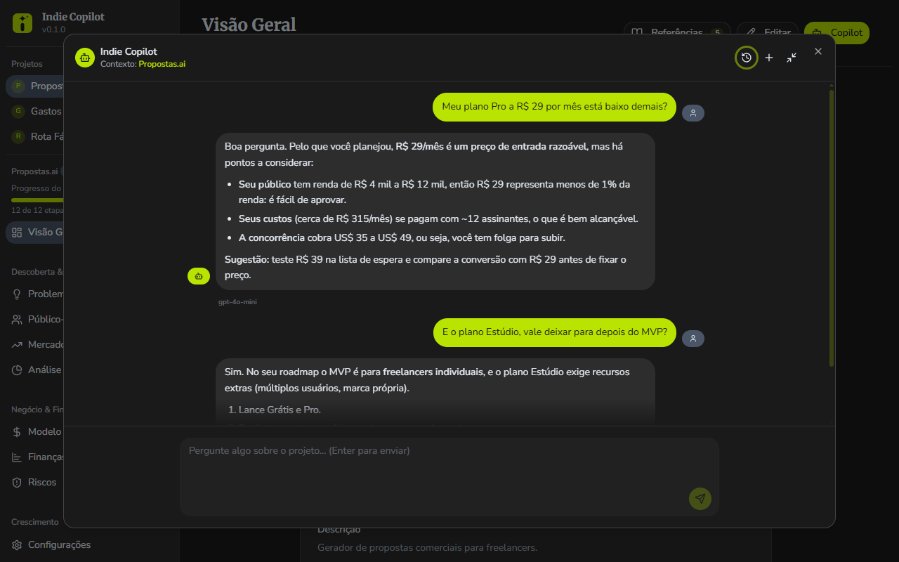

### 📚 Referências em cada página

Cada seção tem uma lista de links e vídeos selecionados para ajudar você a preencher aquela etapa. Os vídeos tocam dentro do próprio app.

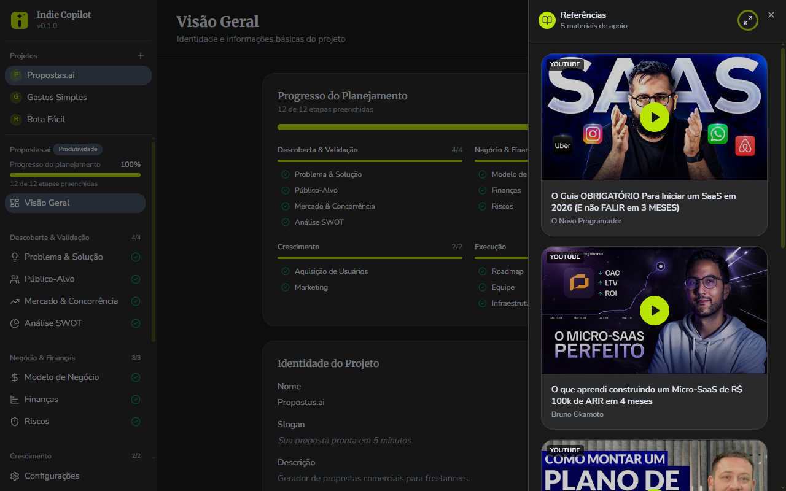

### 🔌 Use a IA que você preferir

O Indie Copilot funciona com qualquer provedor compatível com a API da OpenAI:

- **Na nuvem:** OpenAI, DeepSeek, Groq, OpenRouter e similares.
- **Locais e offline:** Ollama, LM Studio e similares, sem enviar nada para a internet.

Você pode cadastrar vários provedores e alternar entre eles quando quiser.

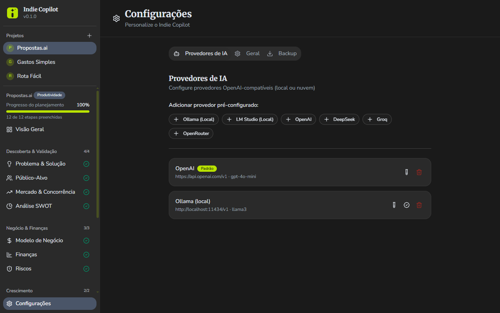

### 🔒 Seus dados, no seu computador

Tudo fica salvo em um banco de dados local. Não existe conta, login ou servidor do Indie Copilot. Você também pode fazer **backup** e **restaurar** tudo em um arquivo, escolhendo onde salvá-lo.

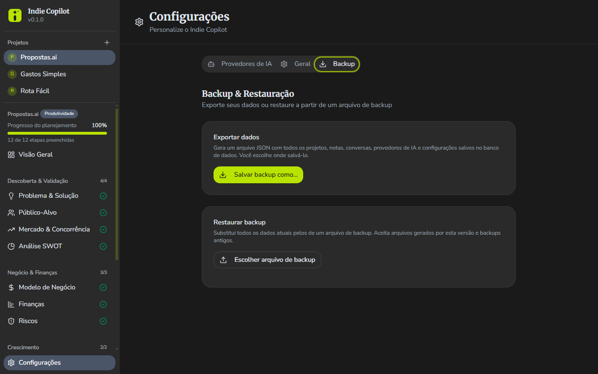

### 🎨 Tema claro e escuro

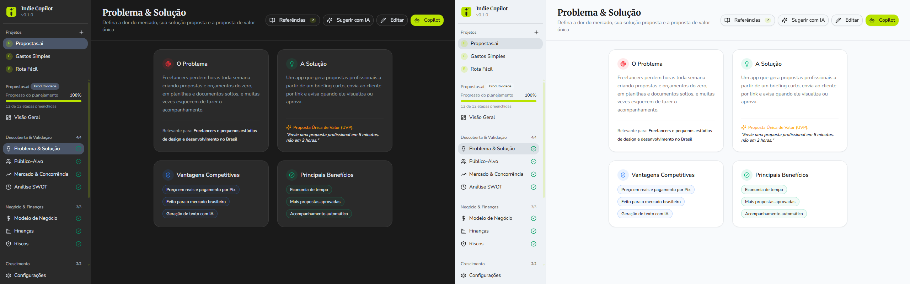

---

## 🚀 Primeiros passos

### 1. Instalar

Baixe o instalador mais recente na página de [**Releases**](https://github.com/marcuth/indie-copilot/releases) e execute-o.

> Prefere compilar você mesmo? Veja [Para desenvolvedores](#-para-desenvolvedores).

### 2. Configurar a IA

Abra **Configurações** e cadastre um provedor de IA:

| Campo         | O que colocar                                                                    |
| ------------- | -------------------------------------------------------------------------------- |
| **URL base**  | O endereço da API do provedor (ex.: `https://api.openai.com/v1` ou `http://localhost:11434/v1` para o Ollama) |
| **Chave de API** | A chave gerada no site do provedor (modelos locais normalmente não exigem)    |
| **Modelo**    | O nome do modelo que você quer usar (ex.: `gpt-4o-mini`, `llama3`)               |

### 3. Criar seu primeiro projeto

Clique para criar um projeto, dê um nome e comece pela seção **Problema & Solução**. Quando tiver algo escrito, abra o Copilot e peça uma opinião.

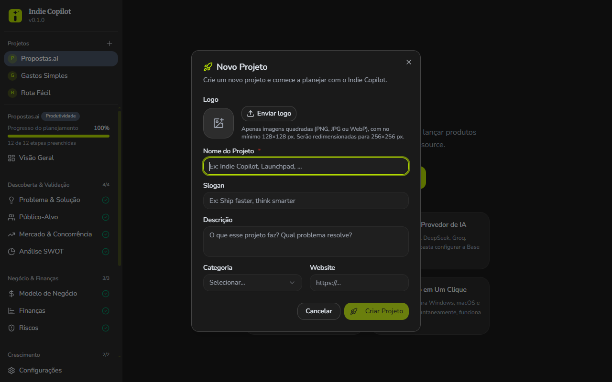

### Dica de fluxo

1. Preencha as seções de **Descoberta & Validação** primeiro.
2. Peça ao Copilot para apontar lacunas e contradições.
3. Siga para **Negócio & Finanças**, depois **Crescimento** e **Execução**.
4. Use as **Notas** para guardar o que surgir no caminho.

---

## ❓ Perguntas frequentes

**Meus dados são enviados para algum lugar?**
Seu planejamento fica só no seu computador. Quando você conversa com o Copilot, o conteúdo do projeto e a sua mensagem são enviados ao provedor de IA que você configurou, e a política de privacidade dele passa a valer. Para que nada saia do seu computador, use um modelo local (Ollama, LM Studio).

**Preciso pagar alguma coisa?**
O Indie Copilot é gratuito e open source. Provedores de IA na nuvem podem cobrar pelo uso da API; modelos locais são gratuitos.

**Onde ficam guardadas as minhas chaves de API?**
No banco de dados local, em texto simples, no seu computador. Não use o app em um computador compartilhado com chaves que você não queira expor.

**O app funciona sem internet?**
Sim, desde que você use um modelo local. O planejamento em si não depende de internet.

**Como troco de computador ou não perco meus projetos?**
Em **Configurações > Backup**, salve um arquivo de backup e restaure-o no outro computador. Atenção: restaurar substitui todos os dados atuais.

**A IA respondeu algo errado.**
Ela é uma ajudante, não uma fonte de verdade. Valide números, mercado e concorrência por conta própria antes de decidir.

---

## 🧑‍💻 Para desenvolvedores

Stack: [Tauri v2](https://tauri.app/) (Rust) + React 19 + TypeScript + Vite 7 + Tailwind CSS 4, com SQLite local e o SDK `openai` com `baseURL` configurável.

**Pré-requisitos:** [Node.js](https://nodejs.org/) 20+, [Rust](https://www.rust-lang.org/tools/install) e as [dependências do Tauri](https://tauri.app/start/prerequisites/) para o seu sistema.

```bash
npm install
npm run tauri dev     # app em modo desenvolvimento
npm run tauri build   # gera o instalador
```

> Use sempre `npm run tauri dev`: rodar só o Vite no navegador não funciona, pois o app precisa do Tauri para abrir o banco de dados.

Mais detalhes em [`CLAUDE.md`](./CLAUDE.md) (arquitetura e convenções) e [`INDIE_COPILOT_SPEC.md`](./INDIE_COPILOT_SPEC.md) (documento de design original).

```bash
npm run ci                    # lint + checagem de formatação
cd src-tauri && cargo test    # testes do backend
```

## 📄 Licença

[MIT](./LICENSE) © [Marcuth](https://marcuth.dev)

---

<div align="center">

Feito com ❤️ por Marcuth.

</div>
